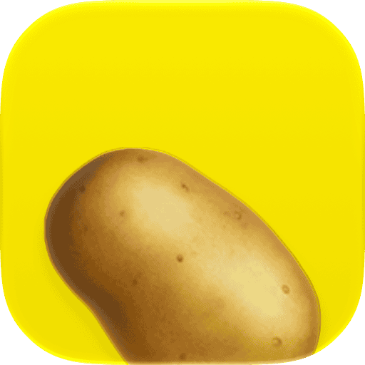
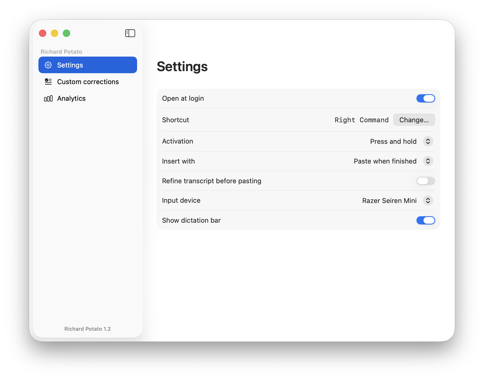
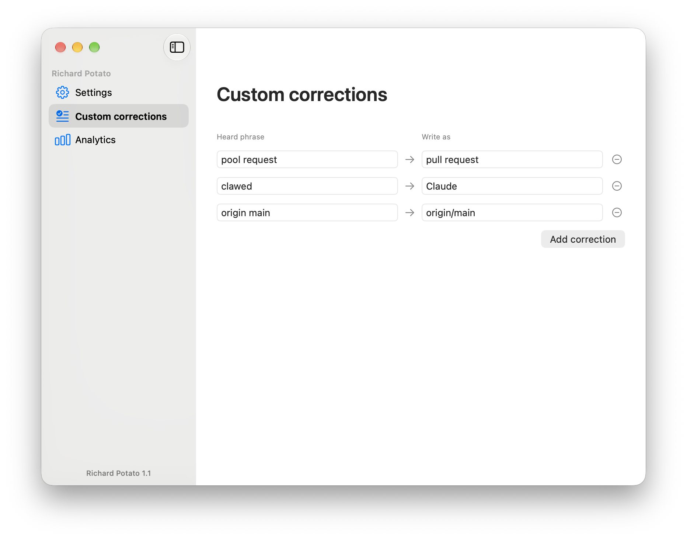
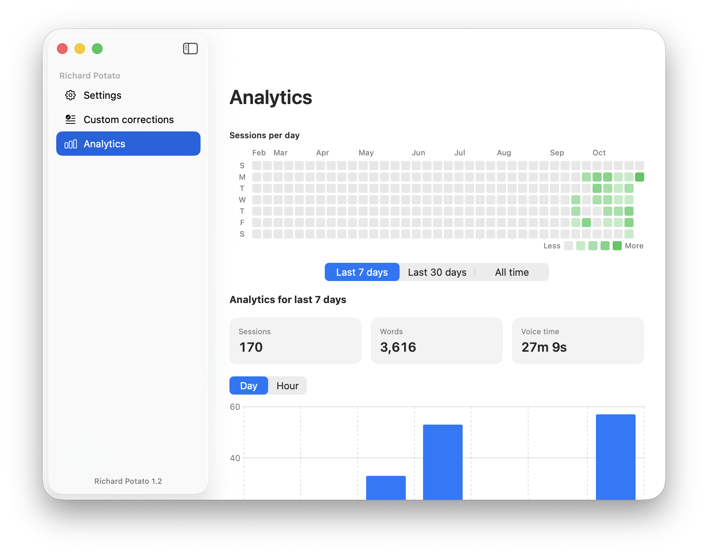

# Richard Potato

Richard Potato is a native macOS application that you use for dictation. It uses Apple's on-device speech model, and so makes no network requests, no language model downloads, and no subscription fees.

---

The native macOS dictation feature works, but suffers slow cold-start times and lacks some basic quality of life features. Richard Potato keeps the dictation model warm, meaning you get instant start for dictation.

Richard Potato supports

- Instant on-device dictation
- Insert as you speak, or wait until you're done
- Can leverage on-device Apple AI model to clean up transcriptions before inserting
- Privacy-focussed analytics, for the stats nerds

## Screenshots

**Dictation bar**


**Settings**



**Custom corrections**



**Analytics**



## Build and run

Requires macOS 26 or later and Swift 6.2 or later with a compatible macOS SDK. The Swift command-line tools are sufficient; a full Xcode installation is not required.

Run the same checks as CI with:

```bash
./scripts/check.sh       # Debug and Release builds, tests, formatting, and metadata
./scripts/test.sh        # Swift Testing suite; accepts --filter
./scripts/format.sh      # Check formatting
./scripts/format.sh fix  # Apply formatting
```

CI runs these checks on macOS 26 for pull requests and pushes to `main`. It compiles the app without packaging or signing it. Automated tests do not verify microphone access, Accessibility access, or dictation in the running app.

Run `swift build` to check compilation. The scripts below also create the app bundle, add its icon and privacy descriptions, and sign it.

Run `./scripts/setup-signing.sh` once to create a local code-signing certificate in your login keychain. This step changes the keychain and may ask for your password. Builds stop if the certificate is missing.

```bash
./scripts/dev.sh      # Build and open the app
./scripts/release.sh  # Build an app and zip in dist/
```

To publish a release, commit and push your changes, then run `./scripts/github-release.sh`. It asks for release notes and uploads the zip to a GitHub release tagged with the project version.

The build script signs Debug and Release apps with the same certificate so macOS can retain their permission grants. A release from this local certificate is not Apple notarized. Recipients may need to right-click the app and select **Open** on first use.

## Use

Grant Microphone and Accessibility access on first use. Use the menu bar icon to open Settings or Analytics. Settings lets you change the shortcut, activation mode, input device, and dictation bar. You can paste finished text or type it while you speak. Paste mode can also show an original and a refined transcript. Custom corrections replace phrases you specify.

The app prepares the speech model at launch. It opens the microphone when dictation starts and closes it when dictation ends. Analytics saves session times, durations, and word counts locally. It does not save audio or transcript text.

## Settings file

All app preferences and custom corrections are stored in:

```text
~/Library/Application Support/Richard Potato/settings.json
```

The path does not depend on the app bundle ID or signing certificate. The JSON
contains a `version` field. Saves use an atomic file replacement and keep the
previous valid settings in `settings.json.bak`. The first save also creates a
backup.

On first use, the app imports UserDefaults from the current app and the known
`com.duncanwilder.RichardPotato` and `com.local.RichardPotato` domains. It combines
distinct corrections from these domains and leaves the old data unchanged.
On the first launch of each app version and build number, the app also checks
these domains and other matching app preference files, including ByHost files.
It adds new replacements to an existing JSON file. Current JSON replacements
have priority for the same phrase. The JSON records the replacements already
found, so later updates do not restore replacements you have deleted. Other
settings in an existing JSON file stay unchanged.

Existing choices, including paste mode, are kept. Version 1.2.1 changed the bundle
ID from `com.local.RichardPotato` to `com.duncanwilder.RichardPotato`. This changed
the UserDefaults domain and can make earlier corrections appear to be lost.

Use **Reveal settings file in Finder** in Settings to find the file. To transfer
preferences to another Mac, quit the app on both Macs and copy `settings.json` to
the same location on the other Mac. Quit the app before you edit the file; changes
are read at the next launch. A microphone selection needs a matching device on
the other Mac. **Open at login** is a macOS registration and must be set on each
Mac. Permissions and analytics are separate from this file.

If the settings file is missing or damaged, the app restores a valid backup when
available. It copies damaged data to `settings.invalid-<unique ID>.json` before
recovery. Recovery and file errors appear in the menu and Settings. If recovery
fails, the app uses temporary default values and blocks saves to protect the
files. Restore a valid file, then restart the app. A settings file from a newer
format is kept unchanged and needs an app that supports that format.

## License

This project is released under [The Unlicense](UNLICENSE).
